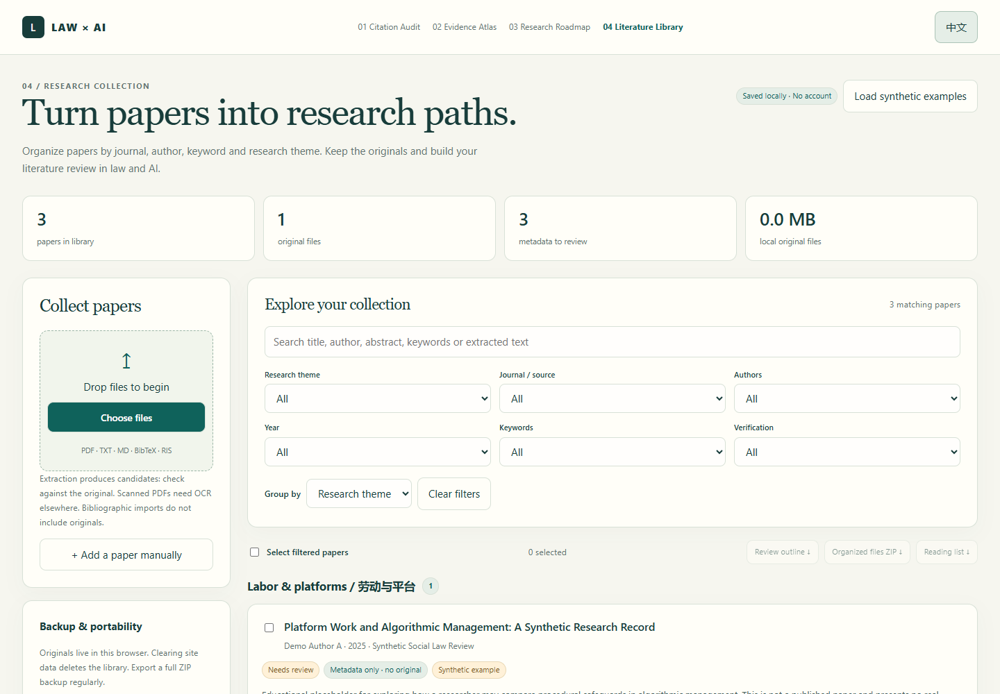

# 04 · Literature Library

**A local-first paper library for social law and AI governance research.**  
**面向社会法与人工智能规制研究的本地文献库。**

[Open the library / 打开文献库](https://josephsun1854.github.io/04-literature-library/) · [Law × AI portfolio / 作品集](https://github.com/JosephSun1854) · [Methods](#methods) · [中文说明](#中文说明)



Organize original papers alongside editable bibliographic records. Slice the collection by journal, author, year, keyword or research theme, find passages in extracted text, and export a review outline grounded in recorded sources.

## Features

- Import **PDF, TXT and Markdown originals**, stored as actual blobs in IndexedDB. Reopen or download them after reloading the page.
- Extract PDF text and embedded metadata using **locally bundled PDF.js**. Extract title, abstract, keywords and DOI candidates; label them as requiring source verification.
- Import **BibTeX and RIS bibliographic records**. These are metadata-only records, with no claim that a paper file is attached.
- Edit titles, authors, journals, years, abstracts, keywords, DOI, research themes and reading notes. Mark a record confirmed after checking the source.
- Attach a PDF/TXT/MD original to an existing bibliographic record. Keep recorded metadata, fill missing fields with extraction candidates and reset verification; replace an original after backing up the previous file.
- Search titles, authors, abstracts, keywords, notes, DOI and extracted text; combine filters and group by any bibliographic dimension.
- Detect byte-identical original files using **SHA-256** before storing another copy.
- Read PDF pages and plain text inside the app; remove a record and its original together in one transaction.
- Export selected originals into folders by **theme or journal**, with a manifest mapping each file to its metadata.
- Export a **complete ZIP backup** containing metadata, extracted text and original bytes. Validate the full archive, paths, file sizes and SHA-256 before an atomic merge.
- Export metadata JSON, a **literature-review Markdown working outline**, and a reading-list JSON compatible with [03 Research Roadmap](https://github.com/JosephSun1854/03-research-roadmap).
- Switch between Chinese and English. Use keyboard navigation and a responsive layout.

## Quick start

Open the [hosted app](https://josephsun1854.github.io/04-literature-library/) in a recent browser. Import a paper, check its candidate metadata in **Details**, assign a research theme and add reading notes. Choose papers and export a review outline or reading list.

The library initially contains **no papers**. “Load synthetic examples” adds two explicitly fictional educational records, with no original files, real authors or asserted research results.

For a small guided exercise, use the [free five-document practice kit / 免费五份材料练习包](tutorials/README.md) or [download its ZIP](https://josephsun1854.github.io/04-literature-library/tutorials/05-practice-kit.zip). All teaching documents are explicitly fictional; keep their labels and do not cite them as real papers. The kit includes original Markdown files, external worksheets and checked output examples, with the original kit README preserved.

For local use, install Node.js 22 or later and run:

```sh
node scripts/serve.mjs
```

Visit `http://127.0.0.1:4174`. There is no build step and no application dependency installation. Browser modules require HTTP(S); double-clicking `index.html` is insufficient.

## Methods

This project treats a document as two linked objects: an **original file** and an **editable bibliographic record**. Classification changes metadata and export folders; it does not alter the original bytes. A full backup includes both objects, linked by ID, file path, size and SHA-256.

PDF.js reads embedded PDF metadata and the text layer. The first **12 pages** are extracted for metadata slicing and search; a record explicitly reports when later pages are not indexed. PDF reading can display every page, and the entire original is retained. Text-based documents use labelled fields and section boundaries such as “Abstract / 摘要” and “Keywords / 关键词”. No external AI is used to infer missing fields.

Extraction yields **candidates without a numerical confidence score**. An embedded PDF author or a first-line title can be inaccurate. Missing journal, author, year, abstract or keyword information is shown explicitly. A user confirmation flag records that the user checked the metadata; it does not certify the underlying paper or its claims.

The review export groups selected records and includes their metadata, recorded abstract, notes and questions for comparing legal problems, jurisdictions, methods, evidence and remaining reading gaps. It generates **no purported research findings, doctrinal conclusions or fabricated citations**.

The research themes emphasize social law, platform labour, algorithmic management, social protection, LLM governance, data and privacy, and accountability. These are editable organizational labels, not conclusions about current law.

## Storage & recovery

All imported materials are processed on the device. The app sends **no document uploads, API requests, analytics or telemetry**. PDF.js, its worker, CMaps, fonts, WASM assets and the ZIP library are served locally from this repository. GitHub Pages still serves the application files; clicking an external source link opens that source normally.

The browser stores data for this site's origin. Private browsing, denied storage, eviction, clearing site data, changing browsers or devices can make the library unavailable. A persistent-storage request can reduce eviction risk but is not a backup. **Export complete ZIP backups regularly.**

The UI reports “saved” only after the IndexedDB transaction completes. If an import fails, the whole prepared batch remains unsaved. Capacity limits are checked in the write transaction as well as before writing. A denied or full database reports failure rather than silently retaining an in-memory collection.

| Export | Metadata | Extracted text | Original bytes | Intended use |
|---|---|---|---|---|
| Full backup ZIP | Yes | Yes | Yes, for attached records | Restore or move the entire library |
| Organized original ZIP | Yes | No | Yes, for selected attached records | Browse classified files outside the app |
| Metadata JSON | Yes | No | No | Share or migrate bibliographic records |
| Reading-list JSON | Selected fields | No | No | Turn selected reading into planner tasks |
| Review outline Markdown | Selected fields + notes | No | No | Draft and compare a review structure |

A **metadata-only import never restores originals**. Missing originals remain visibly marked. Restoring a full backup preserves existing records, remaps colliding IDs, skips byte-identical originals and validates all original hashes before writing anything. To retain an independent copy of the same paper under a different theme, use one record's notes or export it to folders; identical bytes are deduplicated.

## Boundaries

- Recent Chromium, Firefox or Safari with IndexedDB, Web Crypto, ES modules, canvas and native dialogs is required. Testing used current Microsoft Edge.
- Up to **1,000 records**, **40 MiB per file**, **200 MiB total original bytes**; storage quota can be lower.
- ZIP import accepts up to 250 MiB of expanded content plus limited manifest overhead; export buffers files in memory. Large collections may require a smaller selection on memory-constrained devices.
- **Scanned PDFs are not OCRed.** Encrypted or unsupported PDFs may preserve the original without extraction. You can complete metadata manually and download the file for another reader.
- TXT and Markdown are decoded as UTF-8. Other encodings can require conversion before import. Markdown is shown as text, so imported HTML or scripts are not executed.
- BibTeX supports conventional literal brace/quote fields and numeric values. `@string`, macros, concatenation and complex LaTeX normalization are not fully supported; expand macros first. RIS requires completed `TY`–`ER` records.
- A SHA-256 duplicate check detects identical bytes, not revised versions or intellectual similarity.
- This app does not access journal subscriptions, fetch paywalled papers, retrieve online metadata, synchronize across devices or automatically write scholarly arguments.

## Data contracts

A library manifest is JSON with `format: "law-ai-literature-library"`, `schema: 1` and `papers: []`. A full ZIP includes `manifest.json` and the `blobPath` referenced by each attached record. Unreferenced, unsafe, repeated or damaged ZIP entries are rejected. ZIP decoding checks actual output length, CRC-32 and consistent headers using small compressed input chunks; declared sizes alone are insufficient. Original-file SHA-256 hashes and sizes must match the manifest. Stored and DEFLATE ZIP entries are supported; encrypted, multi-disk and ZIP64 archives are rejected.

A planner reading list uses `format: "law-ai-reading-list"`, `version: 1` and `papers: [{ id, title, authors, year, journal, doi, sourceUrl, keywords, themes, abstract, verified, synthetic }]`. The list is explicitly metadata-only. A DOI link is generated only from the recorded DOI; the app does not verify that link.

## Development & verification

```sh
node --check app.js
node --check core.js
node --check storage.js
node --test
```

The tests cover bilingual slicing, missing-field behavior, BibTeX/RIS parsing, archive path safety, manifest validation, composed filters, Markdown provenance and the SHA-256 known test vector. GitHub Actions runs the syntax checks and Node tests.

An optional real-browser integration check verifies import, reload/reopening original bytes, duplicates, PDF parsing/rendering, backup restoration, metadata-only restoration, attaching/replacing originals, damaged ZIP rejection, denied storage, deletion, review export, language switching and mobile layout:

```sh
npm install --no-save playwright pdf-lib
npx playwright install chromium
# Keep node scripts/serve.mjs running in another terminal.
node scripts/browser-check.mjs
```

For an installed Chrome/Edge browser set `BROWSER_CHANNEL=chrome` or `BROWSER_CHANNEL=msedge`. Managed environments may set `RUNTIME_MODULES` to the installed module directory. These packages are development checks only; visitors need none of them.

## Dependencies & credits

| Locally vendored package | Pinned version | License | Source |
|---|---|---|---|
| PDF.js (`pdfjs-dist`) | 6.4.299 | Apache-2.0 | [Mozilla PDF.js](https://github.com/mozilla/pdf.js), [official examples](https://mozilla.github.io/pdf.js/examples/) |
| fflate | 0.8.3 | MIT | [fflate](https://github.com/101arrowz/fflate) |

Upstream licenses are retained in `vendor/pdfjs/LICENSE` and `vendor/fflate/LICENSE`; registry versions and source tarballs are recorded in `vendor/versions.json`. Standard fonts and WASM include the upstream license notices distributed with PDF.js. Application code is licensed under [MIT](LICENSE).

## 中文说明

这是一个无需注册、在浏览器本地使用的论文文献库，服务于社会法、算法管理及大模型法律规制研究。它将**可编辑的书目元数据**与**真实的论文文件原件**关联保存，按期刊、作者、年份、关键词及研究主题筛选、分组，并辅助构建文献综述工作提纲。

1. 导入 PDF、TXT、MD 文件，或导入 BibTeX / RIS 书目。PDF 使用本地 PDF.js 解析；书目导入仅创建元数据，不附带论文文件。
2. 打开文献详情，核对题名、作者、期刊、年份、摘要、关键词与 DOI，补充主题和阅读笔记。提取信息均为候选，缺失项清楚标示，请与原文核验后再勾选确认。
3. 使用搜索与多维筛选定位材料，可在应用内阅读 PDF 页面或文本；刷新后仍可打开与下载已保存的原件。
4. 选择文献，导出按主题 / 期刊归类的原件 ZIP，或导出包含作者、年份、来源、摘要、关键词及比较问题的 Markdown 综述提纲。
5. 定期导出**完整 ZIP 备份**。它包含原件字节与元数据；单独导出元数据 JSON 不包含原件，导入后也不会伪称已还原原件。

所有文档处理均在本地进行，不上传论文，也不调用外部 AI。扫描 PDF 暂不支持 OCR，PDF 全文检索仅索引前 12 页；真实文件完整保留，阅读器可展示所有页面。原件按 SHA-256 去重，删除文献会同时删除该条记录的本地原件。

示例数据仅在点击“载入虚构示例”后加入，并明确标注为教学虚构记录。应用不生成论文研究结论，不替代阅读全文、核验来源与形成自己的学术判断。
